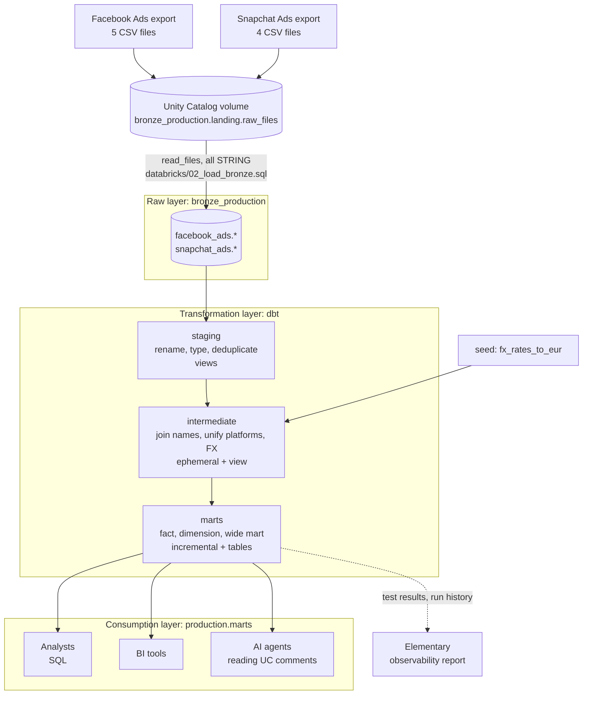
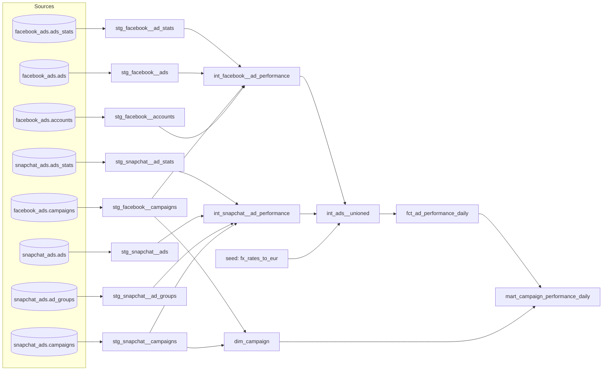
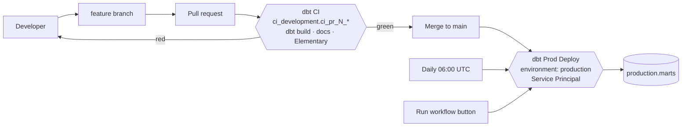

# Marketing Data Platform: Databricks + dbt

A governed, tested and documented marketing dataset that combines **Facebook Ads** and **Snapchat Ads** into one model. Analysts, BI tools and AI agents can answer spend and performance questions without opening either ad platform.

| | |
|---|---|
| **Warehouse** | Databricks (Unity Catalog, SQL warehouse) |
| **Transformation** | dbt-core 1.12 + dbt-databricks |
| **Observability** | Elementary 0.26 |
| **CI/CD** | GitHub Actions |
| **Production identity** | Service Principal `fai-dbt-cdc-marketing-prod` |

---

## Contents

1. [Architecture](#1-architecture)
2. [Repository layout](#2-repository-layout)
3. [Source data and platform differences](#3-source-data-and-platform-differences)
4. [Data model](#4-data-model)
5. [Materializations](#5-materializations)
6. [Data quality](#6-data-quality)
7. [Observability with Elementary](#7-observability-with-elementary)
8. [Documentation and lineage](#8-documentation-and-lineage)
9. [Environments](#9-environments)
10. [Security: Service Principal and Unity Catalog](#10-security-service-principal-and-unity-catalog)
11. [CI/CD](#11-cicd)
12. [Answering the business questions](#12-answering-the-business-questions)
13. [Consumption by analysts, BI and AI agents](#13-consumption-by-analysts-bi-and-ai-agents)
14. [Assumptions and known limitations](#14-assumptions-and-known-limitations)
15. [Setup from scratch](#15-setup-from-scratch)
16. [Day-to-day commands](#16-day-to-day-commands)

---

## 1. Architecture



The four layers the brief asks for are physically separate:

| Layer | Where it lives | Who writes it |
|---|---|---|
| Raw data | `bronze_production` catalog | The load script only (an admin) |
| Transformation logic | dbt models in this repo | Code review via pull requests |
| Analytical models | `production.marts` | The Service Principal, via CI/CD |
| Consumption | `production.marts` + Unity Catalog comments | Read-only for `account users` |

---

## 2. Repository layout

```
DBT/marketing-data-platform/
├── README.md                     ← this file
├── NOTES.md                      ← running decision log
├── requirements.txt              ← pinned dbt, adapter and Elementary CLI versions
├── databricks/
│   ├── 01_setup_catalogs.sql     ← catalogs, landing volume, schemas
│   ├── 02_load_bronze.sql        ← CSV → bronze tables (reproducible load)
│   └── 03_unity_catalog_grants.sql
├── docs/
│   ├── dbt_docs.html             ← static dbt docs (open in a browser)
│   └── elementary_report.html    ← Elementary observability report
└── marketing_platform/           ← the dbt project
    ├── dbt_project.yml
    ├── profiles.yml              ← dev / ci / prod targets, env vars only, no secrets
    ├── packages.yml              ← dbt_utils, elementary
    ├── macros/                   ← safe_divide, generate_schema_name, grant_marts_read_access
    ├── seeds/fx_rates_to_eur.csv
    ├── tests/                    ← singular test: spend reconciles to bronze
    └── models/
        ├── docs.md               ← metric definitions, written once
        ├── staging/{facebook,snapchat}/
        ├── intermediate/
        └── marts/
.github/workflows/                ← at the repository root (GitHub only reads it there)
├── dbt-ci.yml
└── dbt-prod.yml
```

---

## 3. Source data and platform differences

All files are loaded **as-is, every column a STRING**, into `bronze_production`, one table per file, with `_source_file`, `_ingested_at` and `_rescued_data` for lineage. Typing in staging (not at load) means a bad value **fails the dbt build loudly** instead of being silently coerced on the way in.

| Concept | Facebook | Snapchat | Unified as |
|---|---|---|---|
| Ad identifier | `ad_id` (numeric string) | `ad_detail_id` (UUID) | `ad_id` (string) |
| Stats grain | ad × day | ad × day × **country** | ad × day (country summed in staging) |
| Currency | on `accounts.ad_currency_code` (EUR, USD) | on each stats row `ad_currency_code` (EUR) | `currency_code` + `spend_eur` |
| Account | `account_id` on stats rows | only via campaign | `account_id` |
| Path to campaign | ad → campaign | ad → **ad group** → campaign | `campaign_id`, `campaign_name` |
| Ad groups | one row per ad group | **history table**: 3 ad groups appear twice | latest version kept |
| Missing clicks | literal string `'null'` | literal string `'null'` | `0` + `is_clicks_missing = true` |
| Date range | 2025-01-01 → 2025-12-31 | 2024-01-01 → 2024-12-02 | `ad_date` |

---

## 4. Data model

### Layers

| Model | Layer | Grain (one row per…) | Purpose |
|---|---|---|---|
| `stg_facebook__ad_stats` | staging | ad, day | Typed Facebook stats |
| `stg_snapchat__ad_stats` | staging | ad, day | Typed Snapchat stats, **countries summed** |
| `stg_facebook__ads` / `__campaigns` / `__accounts` | staging | ad / campaign / account | Typed descriptive tables |
| `stg_snapchat__ads` / `__ad_groups` / `__campaigns` | staging | ad / ad group / campaign | `ad_groups` deduplicated to the latest version |
| `int_facebook__ad_performance` | intermediate | ad, day | Stats + names + currency |
| `int_snapchat__ad_performance` | intermediate | ad, day | Same columns, **same order** as Facebook |
| `int_ads__unioned` | intermediate | platform, ad, day | Both platforms + `spend_eur` |
| **`fct_ad_performance_daily`** | mart (fact) | **platform, ad, day** | Reusable, additive truth |
| **`dim_campaign`** | mart (dimension) | **platform, campaign** | Campaign names |
| **`mart_campaign_performance_daily`** | mart (wide) | **platform, campaign, day** | Ready-to-query product with CTR, CPC, CPM |

### Why a fact, a dimension *and* a wide mart

- **The fact table** is the detailed, reusable truth that other teams can build on (ad-level attribution, creative analysis). It holds **IDs and additive measures only**. There are no ratios, because ratios can't be summed: averaging per-ad CTRs gives the wrong answer. An AI agent that sees a `ctr` column would happily average it.
- **The dimension** holds descriptive attributes once, so a renamed campaign changes in one place.
- **The wide mart** is the convenient product for the marketing questions. It's already joined and already aggregated to campaign × day, with the ratio metrics computed correctly from sums. Analysts, BI tools and AI agents query it without knowing about joins.

### Keys

| Model | Key | Built from | Why |
|---|---|---|---|
| `fct_ad_performance_daily` | `ad_performance_key` | hash(`platform`, `ad_id`, `ad_date`) | One per grain row; the incremental `merge` key |
| `dim_campaign` | `campaign_key` | hash(`platform`, `campaign_id`) | IDs come from two independent systems, and nothing guarantees a Facebook campaign ID never equals a Snapchat one. Including `platform` makes the key unique **by design**, not by luck |
| `mart_campaign_performance_daily` | (`ad_date`, `platform`, `campaign_key`) | composite | Tested with `unique_combination_of_columns` |

Surrogate keys use `dbt_utils.generate_surrogate_key`. The source's own `_surrogate_key` (Snapchat ad groups) is dropped. It's the source system's row hash, not ours.

### Data types and null handling

- **Money is `decimal(18, 6)`, never `double`**, which avoids floating-point rounding (0.1 + 0.2 ≠ 0.3).
- **`nullif(x, 'null')` then `cast`, never `try_cast`.** `try_cast` turns any unexpected value into NULL silently. `cast` makes `"abc"` fail the build.
- **Missing clicks become `0` with a flag.** `is_clicks_missing` records every substitution, so the assumption stays testable (see the warn test in section 6).
- **Ratios use `safe_divide`, which returns NULL, not 0, on a zero denominator.** CPC with zero clicks isn't "free"; it's undefined. The rule lives in one macro, so every metric behaves the same way.

### Deduplication

`stg_snapchat__ad_groups` keeps the latest version per ad group:

```sql
qualify row_number() over (partition by ad_group_id order by ad_group_updated_at desc) = 1
```

Without it, joining stats to ad groups would match those ads twice and **double their spend**. A `unique` test on `ad_group_id` guards it: if someone removes the `qualify`, the build fails before spend doubles.

### Currency

Facebook spends in EUR **and** USD, so summing `spend` across platforms would mix currencies. `spend_eur` converts using the `fx_rates_to_eur` seed, which holds the ECB 2025 annual average (1 EUR = 1.1300 USD). See section 14 for why an annual rate is acceptable here.

### Business definitions

These are written once in `models/docs.md` and reused on every column that uses them:

| Metric | Definition | Zero denominator |
|---|---|---|
| CTR | `clicks / impressions` | NULL |
| CPC (EUR) | `spend_eur / clicks` | NULL |
| CPM (EUR) | `spend_eur / impressions × 1000` | NULL |

Each definition ends with *"do not average this column; recompute from sums"*, which is aimed at AI agents as much as at humans.

---

## 5. Materializations

The defaults are set per folder in `dbt_project.yml`, and then overridden where there's a reason to.

| Model(s) | Materialization | Why |
|---|---|---|
| staging (8) | **view** | They only rename and cast. A view is free to store and always reflects the latest bronze. |
| `int_facebook__ad_performance`, `int_snapchat__ad_performance` | **ephemeral** | Each is used by exactly one model (`int_ads__unioned`) and is only a few joins. Ephemeral inlines them as CTEs, so there are no extra warehouse objects to secure, document or keep in sync. |
| `int_ads__unioned` | **view** | It's used by the fact table and is worth being able to query directly when debugging a reconciliation gap. That's the trade-off against ephemeral. |
| `fct_ad_performance_daily` | **incremental** (`merge` on `ad_performance_key`) | It's the largest model and grows every day. A daily run only needs recent days, not all history. |
| `dim_campaign`, `mart_campaign_performance_daily` | **table** | These are what people query, so they should be fast. They're small (about 4k and 8k rows), so a full rebuild costs less than incremental bookkeeping. |
| `fx_rates_to_eur` | **seed** | Small, static, version-controlled reference data. |

**How the fact table runs incrementally.** Ad platforms restate recent days (late conversions, spend corrections). So each run re-merges a **3-day lookback window per platform** (`var('fct_lookback_days')`), rather than only loading rows newer than the last run. The watermark is per platform because Facebook and Snapchat data end on different dates. A platform not yet in the table has no watermark and loads in full. `on_schema_change='fail'` stops a silent column mismatch; to change the schema, run with `--full-refresh`.

---

## 6. Data quality

There are **26 tests**. Each one exists to stop a specific failure from reaching a dashboard.

| Test | Model | What it protects against |
|---|---|---|
| `unique` + `not_null` on `ad_performance_key` | fct | Duplicated rows, which double spend |
| `unique_combination_of_columns(ad_id, ad_date)` | both `stg_*__ad_stats` | Snapchat's country collapse failing, so the grain breaks at the source |
| `unique` + `not_null` on `ad_group_id` | `stg_snapchat__ad_groups` | The deduplication being removed, so join fan-out doubles spend |
| `relationships` `campaign_key` → `dim_campaign` | fct | Fact rows pointing at no campaign (referential integrity) |
| `not_null` on `campaign_id`, `campaign_key`, `platform`, `ad_date`, `spend` | fct | A left join quietly finding no match. Left joins keep the row, and the test makes the gap loud. |
| `not_null` on `spend_eur` | fct | A currency or year with no FX rate in the seed |
| `accepted_values` on `platform` and `currency_code` | fct | A new platform or currency arriving unhandled |
| `expression_is_true` `>= 0` on spend, impressions, clicks | fct | Sign errors or corrupt values |
| `expression_is_true` `clicks <= impressions` (**warn**) | fct | Suspicious but possible, so it warns rather than blocks |
| `expression_is_true` `not (is_clicks_missing and impressions > 1000)` (**warn**) | fct | Rows where a missing click count of 0 is probably wrong. **Expected to warn: 322 rows (291 Facebook, 31 Snapchat)** |
| `unique_combination_of_columns(ad_date, platform, campaign_key)` | mart | The wide mart's grain |
| **`assert_fct_spend_reconciles_to_bronze`** (singular) | fct vs bronze | **The strongest test.** Total spend per platform must equal raw bronze to within 0.01, which catches fan-out, dropped rows and broken aggregations in one check |
| `elementary.volume_anomalies` (**warn**) | fct | Row count jumping or dropping compared with previous runs |
| `elementary.schema_changes` (**warn**) | fct | A column added, dropped or retyped upstream |

The tests use dbt 1.10+ syntax: `data_tests:` and `arguments:`. The rename makes it explicit that these test **data**, as distinct from dbt **unit tests**, which test SQL logic against mock data.

**Results:** every environment gives `PASS` on all tests except the one expected `WARN` (the 322 rows), with `ERROR=0`.

---

## 7. Observability with Elementary

dbt tests answer "is the data right *now*?". Elementary answers "how has the project's health changed *over time*?".

- **The `elementary` package** writes every model run and test result into its own schema on every `dbt build`: `production.elementary`, `dev.dbt_faiza_elementary`, and `ci_development.ci_pr_<n>_elementary` in CI. That builds up history automatically.
- **The anomaly tests** (`volume_anomalies`, `schema_changes`) learn from that history. Row counts need a few runs to establish a baseline before they can flag an anomaly.
- **The `edr report` CLI** turns the history into an HTML report covering test results, failed tests, model run times and history, test coverage and lineage. Both workflows generate it on **every run, including failed ones** (`if: always()`, because a failed run is when you need it most), and upload it as a build artifact.
- **A snapshot is committed** at [`docs/elementary_report.html`](docs/elementary_report.html). Download it and open it in a browser.

The package (`packages.yml`) and the CLI (`requirements.txt`) are pinned to the same version, **0.26.0**, as Elementary requires. The CLI reads results through the `elementary` profile in `profiles.yml`.

---

## 8. Documentation and lineage

- **Every source, model and important column has a description.** Grain is stated in every model description. Metric definitions are reused through `{{ doc() }}` blocks.
- **`+persist_docs`** writes those descriptions into **Unity Catalog** as table and column comments. Anyone browsing Catalog Explorer, Databricks' AI assistant, or an AI agent querying the table sees the same definitions as the dbt docs.
- **Static HTML docs**: [`docs/dbt_docs.html`](docs/dbt_docs.html) is generated with `dbt docs generate --static`, a single self-contained file. Open it and click the lineage icon in the bottom right for the full graph. CI and the prod deploy also regenerate it on every run and upload it as an artifact.



---

## 9. Environments

| | Development | CI | Production |
|---|---|---|---|
| dbt target | `dev` | `ci` | `prod` |
| Catalog | `dev` | `ci_development` | `production` |
| Schemas | `dbt_faiza_staging`, `dbt_faiza_marts`, … | `ci_pr_<number>_staging`, … | `staging`, `intermediate`, `marts`, `reference`, `elementary` |
| Runs as | developer (personal token) | developer (personal token, GitHub secret) | **Service Principal** |
| Triggered by | developer, locally | every pull request to `main` | merge to `main`, daily 06:00 UTC, manual |
| Purpose | build and try changes | validate a change before merge | serve consumers |

- **One `profiles.yml`, committed, containing no secrets.** Every credential comes from an environment variable. GitHub Actions and local runs use the same file.
- **Schema naming** (`macros/generate_schema_name.sql`): dev and CI prefix every schema, so developers and concurrent pull requests never collide. Prod gets clean names (`production.marts`), so consumers and AI agents see readable names.
- **The `prod` target has no personal token at all.** It can only authenticate as the Service Principal.

---

## 10. Security: Service Principal and Unity Catalog

### Production identity

Production runs as the **Service Principal `fai-dbt-cdc-marketing-prod`** (Application ID `a57ae139-8cb6-4c18-b0b2-35a7d5a9b68c`), never as a person. That means:

- nothing breaks when someone leaves the company,
- a leaked developer token can't touch production,
- audit logs say *the job* ran it, not *Faiza*,
- its permissions are exactly what the job needs (**least privilege**).

**Authentication: the plan, and what Free Edition forced.** The intended design is **OAuth M2M**: the Service Principal exchanges a client ID and secret for a short-lived token on every run. That was set up, and it is the right production answer. But this workspace runs on **Databricks Free Edition, which refuses to issue OAuth scopes to Service Principals**. The secret authenticates, then the workspace rejects it with `access_denied: Scopes 'all-apis' are not assigned to the client` (the same happens for `sql`). This was verified directly against the token endpoint.

The fallback keeps the important property: **production still runs as the Service Principal, not a person.** It uses a **token owned by the Service Principal** (an on-behalf-of token), created by an admin with a **90-day expiry**:

| | OAuth M2M (target) | Service Principal's token (used) |
|---|---|---|
| Identity | Service Principal | Service Principal |
| Permissions | Least privilege | Least privilege, the same grants |
| Credential lifetime | About 1 hour per run | 90 days, so it must be rotated |
| Stored | GitHub `production` environment | GitHub `production` environment; locally the macOS Keychain |

On a paid workspace, switching to OAuth M2M means changing **only** the `prod` output in `profiles.yml` (`auth_type: oauth`, `client_id`, `client_secret`) and the two secrets. No model code changes.

Proof the Service Principal built production: every table, view and schema in `production` has owner and `created_by` = `a57ae139-…`. A login test as the Service Principal can read bronze and production, and **is refused** on a developer's dev schema.

### Unity Catalog grants

These are in [`databricks/03_unity_catalog_grants.sql`](databricks/03_unity_catalog_grants.sql). The brief says to *adapt* its example, so the differences are deliberate:

| Brief's example | This project | Reason |
|---|---|---|
| `CREATE SCHEMA` / `CREATE TABLE` on `bronze_production` | **Not granted.** `USE` + `SELECT` only | The job only reads raw data. If it could write there, a model bug could corrupt the source of truth. Only the load writes to bronze. |
| `CREATE CATALOG ON METASTORE` | **Not granted** | A metastore-wide privilege. Catalogs are created once by an admin (`01_setup_catalogs.sql`). |
| (no `MODIFY` in the example either) | No `MODIFY` on `production` | The Service Principal **owns** the schemas and tables it creates, and owners already have full rights. |
| CI grants for the developer's email | Same, on `ci_development` | CI runs as the developer, as the brief asks |
| (not covered) | **Consumers get `USE CATALOG` on `production`, and `USE SCHEMA` + `SELECT` on `marts` only** | Granted by dbt itself at the end of every prod run (`macros/grant_marts_read_access.sql`). Staging and intermediate stay internal, and only the marts are a public interface. |

The Service Principal also needs **Can use** on the SQL warehouse. Without it, no query runs, whatever the data grants.

### Secrets

- **Never in Git.** `profiles.yml` only references `env_var(...)`, and `.env` is gitignored (checked with `git check-ignore`).
- **Locally**, `.env` doesn't even hold the tokens. It fetches them from the **macOS Keychain** at `source` time.
- **In GitHub**, the developer token is a repository secret (used by CI). The **Service Principal's token is a secret of the `production` environment only**, so a pull request job can never read it.

---

## 11. CI/CD



| | `dbt-ci.yml` | `dbt-prod.yml` |
|---|---|---|
| Trigger | pull request to `main` touching this project | push to `main` touching this project, daily cron, manual |
| Identity | developer token | Service Principal token (`environment: production`) |
| Steps | `dbt deps` → `dbt build --target ci` → static docs → Elementary report → upload | `dbt deps` → `dbt build --target prod` → static docs → Elementary report → upload |
| Concurrency | `cancel-in-progress: true`, because only the newest commit matters | `cancel-in-progress: false`, so a prod run is **never killed halfway**, which could leave tables half-updated |
| Isolation | each PR gets its own schemas, `ci_pr_<number>_*` | — |

- `paths:` filters mean the workflows only run when this project changes, not when other course folders do.
- `dbt build` runs seeds, models and tests **in dependency order**. If a staging test fails, everything downstream is skipped, so bad data never reaches the marts.
- **Code reaches production only through a reviewed, tested pull request, never from a laptop.**

The flow was proven end to end on PR #1: [CI run](https://github.com/FaizaJibril/Core-Data-Engineers/actions/runs/39485964488) (`PASS=38 WARN=1 ERROR=0`), then the [prod deploy](https://github.com/FaizaJibril/Core-Data-Engineers/actions/runs/39487337687) as the Service Principal (`PASS=38 WARN=1 ERROR=0`).

---

## 12. Answering the business questions

All queries run against `production.marts.mart_campaign_performance_daily`. To compare or total spend across platforms, use `spend_eur`.

**Total spend, impressions and clicks**

```sql
SELECT round(sum(spend_eur), 2) AS spend_eur, sum(impressions) AS impressions, sum(clicks) AS clicks
FROM production.marts.mart_campaign_performance_daily;
```
→ **€8,672,328.76**, **938,845,205** impressions, **5,756,722** clicks.

**Facebook vs Snapchat: spend, impressions, clicks, CTR, CPC, CPM**

```sql
SELECT platform,
       round(sum(spend_eur), 2)                                     AS spend_eur,
       sum(impressions)                                             AS impressions,
       sum(clicks)                                                  AS clicks,
       round(sum(clicks) / nullif(sum(impressions), 0) * 100, 3)    AS ctr_pct,
       round(sum(spend_eur) / nullif(sum(clicks), 0), 2)            AS cpc_eur,
       round(sum(spend_eur) / nullif(sum(impressions), 0) * 1000, 2) AS cpm_eur
FROM production.marts.mart_campaign_performance_daily
GROUP BY platform;
```

| platform | spend_eur | impressions | clicks | CTR | CPC (EUR) |
|---|---|---|---|---|---|
| facebook | 8,641,799.22 | 905,449,421 | 5,737,710 | 0.634% | 1.51 |
| snapchat | 30,529.54 | 33,395,784 | 19,012 | 0.057% | 1.61 |

> ⚠️ Facebook data covers **2025** and Snapchat covers **2024**, so this compares different periods, not the same one. The caveat is written into the mart's description, so an AI agent sees it too.

**Campaigns with the most clicks and impressions**

```sql
SELECT platform, campaign_name, sum(clicks) AS clicks, sum(impressions) AS impressions, round(sum(spend_eur), 2) AS spend_eur
FROM production.marts.mart_campaign_performance_daily
GROUP BY platform, campaign_name
ORDER BY clicks DESC      -- or impressions DESC
LIMIT 10;
```

**Performance over time**

```sql
SELECT date_trunc('month', ad_date) AS month, platform,
       round(sum(spend_eur), 2) AS spend_eur, sum(clicks) AS clicks,
       round(sum(clicks) / nullif(sum(impressions), 0) * 100, 3) AS ctr_pct
FROM production.marts.mart_campaign_performance_daily
GROUP BY 1, 2
ORDER BY 1, 2;
```

**Ratios at any level:** always recompute them as `sum(numerator) / sum(denominator)` for the level you need. **Never average** the `ctr`, `cpc_eur` or `cpm_eur` columns.

---

## 13. Consumption by analysts, BI and AI agents

The final model is treated as a **data product**, not just a table:

- **Clear names**: `spend_eur`, `cpc_eur`, `is_clicks_missing`. Units are in the name, and prod schemas have no developer prefixes.
- **One definition per metric**, written once in `docs.md` and pushed into Unity Catalog comments with `persist_docs`. An AI agent reading the table metadata gets the same definitions *and* the warnings ("do not average", "never sum `spend` across currencies", "the platforms cover different years").
- **Ratios precomputed correctly** in the wide mart, so a simple question doesn't need a correct formula from the asker.
- **Tested and monitored**: every answer rests on the 26 tests and the reconciliation to bronze.
- **Least-privilege read access**: consumers see `production.marts`, not the internal layers.

Example questions this supports directly: *"How much did we spend on Facebook last month?"* (filter `platform`, `ad_date`, then sum `spend_eur`), *"Which campaign had the highest number of clicks?"*, *"Compare Facebook and Snapchat spend."*

---

## 14. Assumptions and known limitations

- **FX uses one annual average rate per currency and year** (seed `fx_rates_to_eur`, ECB 2025 reference rate: 1 EUR = 1.1300 USD). That's accurate enough to compare platforms, but **not for finance reconciliation**. A production setup would load daily rates from an FX feed. There's no USD rate for 2024 because no USD spend exists in 2024, and the `not_null` test on `spend_eur` fails if a currency or year without a rate ever appears.
- **The platforms cover different years** (Snapchat 2024, Facebook 2025), so same-period comparisons aren't possible with this data.
- **Missing clicks are stored as 0**, flagged by `is_clicks_missing`. That affects 24,337 Facebook and 48 Snapchat rows, and 322 of them have over 1,000 impressions (the warn test).
- **`ad_date` is in each platform account's own timezone.** No timezone normalisation was possible from the exports.
- **Snapchat has no accounts table**, so `account_name` is NULL for Snapchat.
- **Production authentication is a Service Principal token, not OAuth M2M**, because of the Free Edition limitation (section 10). The token expires about 90 days after creation and must be rotated.
- **Bronze is a full snapshot reload** (`CREATE OR REPLACE`), because the exports are full files. A real feed would land incrementally, for example with Auto Loader.

---

## 15. Setup from scratch

1. **Databricks (as an admin):** run [`databricks/01_setup_catalogs.sql`](databricks/01_setup_catalogs.sql), upload the CSVs to `/Volumes/bronze_production/landing/raw_files/{facebook,snapchat}/`, then run [`02_load_bronze.sql`](databricks/02_load_bronze.sql).
2. **Service Principal:** **Settings → Workspace admin → Identity and access → Service principals → Add**. Enable *Workspace access* and *Databricks SQL access*, give it **Can use** on the SQL warehouse, then run [`03_unity_catalog_grants.sql`](databricks/03_unity_catalog_grants.sql) with your Application ID.
3. **Production credential:** on a paid workspace, generate an OAuth secret on the Service Principal. On Free Edition, give the Service Principal **Can use** on *Personal access tokens* and create an on-behalf-of token for it with a 90-day expiry.
4. **Local environment:**
   ```bash
   cd DBT/marketing-data-platform
   python -m venv .venv && source .venv/bin/activate
   pip install -r requirements.txt
   # store tokens in the macOS Keychain (prompts for the value; nothing is echoed)
   security add-generic-password -a "$USER" -s dbt-marketing-dev-token -w
   security add-generic-password -a "$USER" -s dbt-marketing-prod-token -w
   ```
   Create `.env` (it's gitignored; check with `git check-ignore -v .env`):
   ```bash
   export DATABRICKS_HOST=<workspace host>
   export DATABRICKS_HTTP_PATH=/sql/1.0/warehouses/<warehouse id>
   export DATABRICKS_TOKEN=$(security find-generic-password -s dbt-marketing-dev-token -w)
   export DATABRICKS_SP_TOKEN=$(security find-generic-password -s dbt-marketing-prod-token -w)
   ```
5. **GitHub → Settings → Secrets and variables → Actions:**
   - repository secrets: `DATABRICKS_HOST`, `DATABRICKS_HTTP_PATH`, `DATABRICKS_TOKEN`
   - **Environments → `production`**: `DATABRICKS_SP_TOKEN`
6. **First build:**
   ```bash
   cd marketing_platform && source ../.env
   dbt deps && dbt debug && dbt build
   ```

---

## 16. Day-to-day commands

Run these from `marketing_platform/` after `source ../.env`. Run the `source` again in every new terminal.

| Task | Command |
|---|---|
| Build and test everything in dev | `dbt build` |
| Build one model and everything downstream | `dbt build --select fct_ad_performance_daily+` |
| Rebuild the incremental fact from scratch | `dbt build --select fct_ad_performance_daily --full-refresh` |
| Widen the incremental lookback | `dbt build --vars '{fct_lookback_days: 7}'` |
| Static docs | `dbt docs generate --static`, then open `target/static_index.html` |
| Interactive docs | `dbt docs generate && dbt docs serve` |
| Elementary report | `edr report --profiles-dir . --project-dir . --profile-target dev` |
| List tests | `dbt ls --resource-type test --quiet` |

Production is deployed by merging to `main`, never from a laptop.
